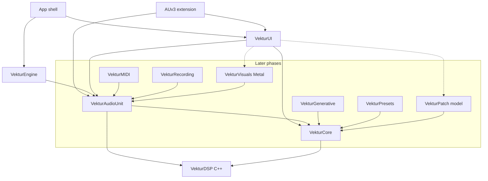
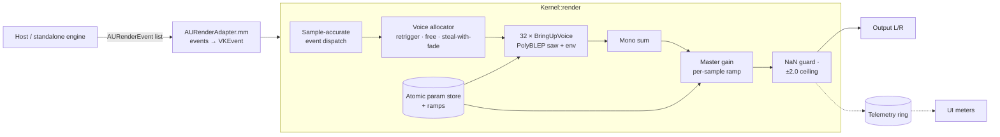
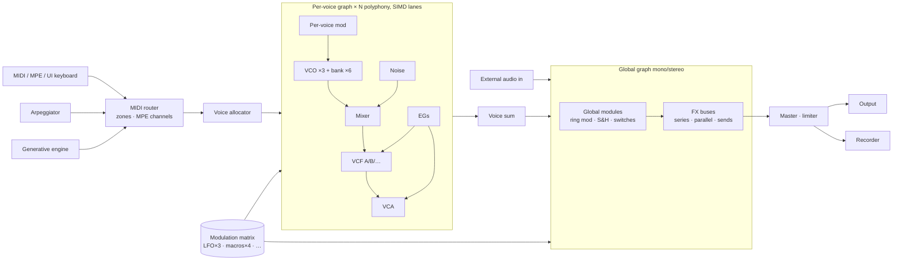

# Vektur Modular — Technical Audit & Architecture

Status: **Phase 1 baseline** · Schema version 1 · Last updated 2026-11-27

This document is the technical foundation the other ten phases build on. It
covers the audit (§1), technology decisions (§2), component architecture and
dependency map (§3), real-time model (§4), signal flow (§5), parameter
architecture (§6), AUv3 state-management plan (§7), the modular-graph design
that Phase 2–3 will implement (§8), and the risk register (§9).

---

## 1. Technical audit

| Item | Finding |
|---|---|
| Existing project | None supplied. Greenfield. Nothing to preserve. |
| Existing Xcode targets | None. Created: `VekturModular_iOS`, `VekturModular_macOS`, `VekturModularAU_iOS`, `VekturModularAU_macOS` (XcodeGen, `project.yml`). |
| Existing AudioKit / Core Audio deps | None. Phase 1 uses Core Audio / AudioToolbox / AVFoundation / CoreMIDI directly; AudioKit deliberately not linked yet (§2.3). |
| Swift version | Swift 6 language mode, `SWIFT_STRICT_CONCURRENCY = complete`. Requires Xcode 16+. |
| Deployment targets | iOS/iPadOS 17.0, macOS 14.0 (matches the rest of the Vektur line). |
| AUv3 architecture | One `AUAudioUnit` subclass in a Swift package, shared by the extension and the standalone app (which hosts it in-process). Extension principal class is an `AUViewController` that also implements `AUAudioUnitFactory`. |
| Licensing — AudioKit | MIT. Compatible with closed-source App Store distribution. |
| Licensing — Ableton Link | Desktop source is GPLv2+, with a separate proprietary licence on request from Ableton. iOS apps use the **LinkKit** SDK under Ableton's SDK licence. iOS also requires the **multicast networking entitlement** (`com.apple.developer.networking.multicast`), which must be requested from Apple. Start that request early — it gates Phase 7. |
| Licensing — reference hardware | The two reference architectures (A: 1970s semi-modular with keyboard and sequencer; B: the larger modular system of the same era) are named only in the legal disclaimer. No graphics, panel layouts, manuals, firmware or samples copied. Product renamed from the working title to **Vektur Modular** (2026-11-27) so no product name, bundle ID or component code contains a reference model designation (§9 R-12). |
| Platform limits that shape design | iOS AUv3 extensions run with a constrained memory budget and no guaranteed background time; they cannot keep a host alive; UDP multicast (Link) needs an entitlement; microphone needs a usage string and a runtime request; external display and Stage Manager support vary by iPad model. |
| Build environment for this phase | The C++ DSP core was compiled and tested here (clang 18 `-Werror`, g++ 13 with ASan/UBSan and TSan). **No Swift toolchain was available**, so the Swift and Xcode targets are written but not yet compiled — first compile happens on your Mac (see PHASE1_REPORT.md). |

---

## 2. Technology decisions

### 2.1 Language split
- **C++20 DSP core** (`VekturDSP`) behind a **plain-C header**. Real-time code
  in Swift is possible but hard to keep allocation- and ARC-free under Swift 6;
  C++ gives deterministic control and lets the core be tested on any machine.
  The C header means Swift needs no C++-interop build flags.
- **Swift 6** for everything not on the audio thread: parameters, state,
  hosting, MIDI services, UI, persistence.
- **Objective-C++** for exactly one file (`AURenderAdapter.mm`) because the
  `AURenderEvent` types live in an Objective-C header. No Obj-C objects are
  touched at render time.

### 2.2 UI
SwiftUI for screens; UIKit/AppKit only where needed (AUv3 view controller,
later the patch canvas gesture layer). The patch canvas and cable animation
(Phase 3/8) will render with **Metal** (or Core Animation layers if profiling
allows) because hundreds of animated, zoomable cables at 500% exceed what
SwiftUI `Canvas` does efficiently.

### 2.3 AudioKit — why not yet
The prompt asks for AudioKit "for appropriate audio infrastructure". In Phase 1
nothing it provides is needed: the AU, engine hosting, MIDI and DSP are all
direct Apple APIs or our own C++. Linking it now would add an unused dependency
(contradicting "no unnecessary dependencies"). Candidate later uses, each to be
justified when reached: AudioKit's MIDI utilities (Phase 7), file/recording
helpers (Phase 9), and `AudioKitUI` waveform views only if they beat our own
telemetry renderer. AudioKit's stock oscillators/filters will **not** be used
for the analogue engine — those must be our circuit-informed models.

### 2.4 Persistence
One `Codable`, versioned `InstrumentState` (JSON) for AUv3 `fullState`, user
presets, factory presets and standalone sessions. Preset *library* metadata
(favourites, tags, search) will use **SwiftData** in Phase 9; preset *content*
stays in the versioned JSON so it can be migrated, exported and validated
independently of the database.

### 2.5 Project generation
**XcodeGen** (`project.yml`). The `.xcodeproj` is generated, never hand-edited,
which keeps diffs readable and avoids project-file merge damage.

---

## 3. Component architecture

### 3.1 The sixteen components → where they live

| # | Component | Location | Phase |
|---|---|---|---|
| 1 | Application shell | `App/` | 1 ✔ |
| 2 | Audio engine (hosting, session, lifecycle) | `VekturEngine` | 1 ✔ |
| 3 | Analogue synthesis engine | `VekturDSP/modules/*` | 2 |
| 4 | Modular patching engine (graph compiler, runtime) | `VekturDSP/graph/*` + `VekturPatch` (Swift model) | 2–3 |
| 5 | Modulation engine | `VekturDSP/mod/*` | 4 |
| 6 | Arpeggiator engine (+ step sequencer) | `VekturDSP/seq/Arpeggiator.hpp`, `StepSequencer.hpp` | 5 ✔ |
| 7 | Generative music engine (+ preset creator) | `VekturDSP/seq/Generative.*`, `PresetGenerator.cpp` (C++, in-kernel, bar-locked; moved from the planned Swift module so it is sample-accurate and testable) | 5 ✔ |
| 8 | Effects engine | `VekturDSP/fx/*` (C++ engine + 27 effects), `VekturAudioUnit/Effects.swift` | 6 ✔ |
| 9 | MIDI engine (learn, profiles, MPE, clock) | `VekturMIDI` (Swift) + kernel MIDI router | 4/7 |
| 10 | AUv3 integration | `VekturAudioUnit`, `AUExtension/` | 1 ✔ (base) / 7 |
| 11 | Preset & state management | `VekturCore` (state) + `VekturPresets` | 1 ✔ (state) / 9 |
| 12 | Recording & export | `VekturRecording` | 9 |
| 13 | Visualisation engine | telemetry rings (C++) + `VekturVisuals` (Metal) | 1 ✔ (meters) / 3, 8 |
| 14 | UI components | `VekturUI` | 1 (diagnostics) / 8 |
| 15 | Settings & configuration | `VekturSettings` | 10 |
| 16 | Documentation & help | `docs/` + `VekturHelp` (bundled manual) | 9 |

### 3.2 Module dependency map



Rules enforced by the package graph:
- `VekturDSP` depends on nothing (no SwiftUI, no Foundation, no Obj-C at render time).
- `VekturCore` has no UI and no AudioUnit dependency; it is testable headless.
- Only `VekturUI` imports SwiftUI. The engine never depends on UI.
- Each later-phase module gets its own target, its own tests, and only the
  dependencies shown.

---

## 4. Real-time model

Threads and who owns what:

| Thread | Does | Never does |
|---|---|---|
| **Render** (host / Core Audio) | `vk_au_render` → convert events → `Kernel::render` | allocate, lock, log, file/network I/O, Obj-C/Swift calls, unbounded loops |
| **Main / UI** | parameter edits via AUParameter, commands, telemetry drain, graph edits | touch kernel internals directly |
| **Host parameter thread** | `implementorValueObserver` → atomic store | anything else |
| **CoreMIDI thread** (standalone) | UMP event lists → `scheduleMIDIEventListBlock` (MIDI 2.0), or bytes → `scheduleMIDIEventBlock` | touch kernel directly |
| **MIDI queue** (Phase 7, utility) | 30 Hz drain of the kernel's MIDI UI queue: learn results, program change, MIDI-changed parameters → AU tree | run on the render thread |
| **Worker** (Phase 2+) | compile patch graphs, load IRs, build wavetables | — |

Communication primitives (all preallocated, wait-free):
- **Parameters**: flat `std::atomic<float>` array indexed by address
  (`VK_ADDRESS_SPACE` = 16 384). Render polls registered slots once per 32-frame
  control block and ramps; host automation arrives as sample-accurate events
  with optional explicit ramps.
- **Commands UI→audio**: `SPSCQueue<VKCommand, 256>`.
- **Telemetry audio→UI**: `SPSCQueue<VKTelemetry, 256>`; UI drains at display
  rate; if full, telemetry is dropped, never the audio.
- **MIDI (Phase 7)**: Learn mappings UI→audio through a triple buffer
  (`midi::MappingExchange`, 256 entries); MIDI UI events audio→UI through
  `SPSCQueue<VKMidiUIEvent, 256>` (single consumer: the MIDI queue); parameters
  MIDI changed are a per-address atomic dirty bitset. MIDI output is a
  per-buffer array (512 events) handed to the host's `AUMIDIOutputEventBlock` by
  the Objective-C++ adapter after `Kernel::render` — the host's block is the one
  call out of the kernel on the render thread, as Apple specifies.
- **Graph swaps (Phase 2–3)**: compiled graph built on a worker, published by
  atomic pointer exchange at a block boundary, old graph returned to a
  "retire" SPSC queue and freed off-thread (see §8).

Render loop: events applied at their exact sample offset; audio rendered in
spans ending at the next event or the 32-frame control boundary; output passes
a NaN/Inf guard and a ±2.0 hard safety ceiling (flagged in telemetry, should
never engage in normal use).

---

## 5. Audio signal flow

### 5.1 Phase 1 (implemented)



### 5.2 Target architecture (Phases 2–6)



Patch cables can connect modules inside the per-voice graph, inside the global
graph, and across them (poly→mono sums, mono→poly broadcasts). Normalled
connections are default cables flagged `normalled`; inserting a user cable into
a normalled input replaces it (§8).

---

## 6. Parameter architecture

- **Address** = `module × 256 + index` (`VK_PARAMS_PER_MODULE`). 64 modules ×
  256 = 16 384 addresses.
- **Single source:** `tools/params.py` holds every parameter (id, address,
  range, default, smoothing, taper, labels) and generates `VekturParams.h`
  (C constants, imported by Swift), `ParamTable.hpp` (kernel self-registration)
  and `ParameterRegistry+Generated.swift`. It refuses to run if a shipped
  address moves or two parameters collide. Phase 2: 87 parameters.
- **Identifier** = stable dotted string (`global.masterVolume`, later
  `osc1.coarse`, `vcfA.cutoff`) — the key in saved state and the AUParameter
  identifier.
- Both are **permanent once shipped**. `ParameterRegistryStabilityTests` pins
  every shipped pair; a change fails the test suite.
- **Reserved module blocks** (fixed now so later phases cannot collide):

| Module id | Block |
|---|---|
| 0 | Global (volume, tune, polyphony, bend range; voice mode, priority, glide mode, unison, bend-down at indices 10–16) |
| 1–3 | Core oscillators VCO 1–3 |
| 4–9 | Expanded oscillator bank 1–6 |
| 10–17 | Filters (A SVF, B ladder, diode, transistor, OTA, comb, formant, bank/VCBPF) |
| 18–19 | VCAs |
| 20–25 | Envelope generators 1–6 |
| 26–28 | LFOs 1–3 (implemented 4A; also rack modules `lfo1…3`) |
| 29 | Macros 1–4 (implemented 4A) |
| 30–35 | Utility modules (noise, ring mod, S&H, slew, follower, voltage processors) |
| 36–37 | Arpeggiator / step sequencer (implemented 5) |
| 38 | Generative engine (implemented 5) |
| 39–46 | Effect slots 1–8 (implemented 6): type, on, mix, output, bus, p1…p12 (meaning per type, `fx/FxSpecs.cpp`) |
| 47 | Effects buses (implemented 6) |
| 48–55 | Spare (effects) |
| 56–59 | Mixer (4-ch), analogue switch, gate delay, transistor ladder |
| 60 | Modulation matrix: 16 slots × 16 indices (implemented 4A) |
| 61–63 | Spare |

- **Exposure policy**: only parameters that are meaningful to automate and
  connected to DSP. Patch-graph topology, cable colours, workspace layout and
  modulation-matrix routing are *state*, not host parameters. Modulation
  amounts that users want to automate are exposed through the four macros
  rather than as thousands of per-slot parameters. Target: ≤ ~800 parameters
  at v1.0 (revised in Phase 6 from 600: effects use 12 generic, type-defined
  parameters per slot instead of per-effect parameter sets).
- Modules not present in a user's patch keep their parameters (addresses are
  fixed), so automation never points at a re-numbered control.

---

## 7. AUv3 state-management plan

**Format.** `InstrumentState` JSON (sorted keys), stored in `fullState` under
`com.dreammusictemple.vekturmodular.state`, alongside the keys `AUAudioUnit` writes
itself (type/subtype/manufacturer/version). Standalone sessions and user/
factory presets use the identical blob.

**Contents by phase.**

| Section | Phase | Notes |
|---|---|---|
| `schemaVersion`, `writtenBy`, `parameters`, `preset` | 1 ✔ | |
| `patch` (modules, positions, cables, colours, opacity, normalling overrides, locks) | 3 | |
| `workspace` (zoom, scroll, layout, groups, labels) | 3 | |
| `modMatrix`, `macros` | 4 | |
| `keyboard` (zones, voice mode, MPE config, polyphony mode) | 4 | |
| `arp`, `sequencer`, `generative` (incl. seeds, captured clips) | 5 ✔ | Settings and seeds are parameters (modules 36–38); captured clips are the optional `clips` section |
| `effects` (chain, buses, per-effect settings, IR references) | 6 ✔ | Chain, buses and settings are parameters (modules 39–47); the `effects` section holds user-IR references by SHA-256; files live in the app-group IR library |
| `midi` (per-preset learn mappings; global mappings & hardware profiles are app settings) | 7 ✔ | Mappings by parameter identifier; global mappings live in the app group's defaults; profiles are `.vekturmidi` JSON files |
| `appearance` (rack Wear, per-module Wear, tilt highlights) | 8 ✔ | Optional section, default not written |
| `tempo` (internal tempo, sync source) | 5/7 ✔ | Both are parameters (`global.tempo`, `global.syncSource`) |

**Write path.** `fullState.get` → `captureState()` (parameters read live from
the tree; other sections from the lock-protected cached state) → `StateCodec.encode`.

**Read path.** `fullState.set` → `super.fullState = …` → extract blob →
`StateCodec.decode` (8 MB size cap → JSON parse → **migrate** → typed decode →
**sanitise**) → `apply()`; on any error, the current state is kept and the
error logged — never a crash, never a half-applied patch.

**Compatibility rules.**
1. Additive changes: new optional section/parameter, decoded with defaults. No
   schema bump needed.
2. Breaking changes: bump `currentSchemaVersion`, add one `StateMigrator` step
   (`n → n+1`) operating on raw JSON. Shipped steps are never edited.
3. Newer-than-current state: loaded best-effort; unknown sections and unknown
   parameter ids are preserved and written back unchanged (round-trip safe when
   users move projects between devices on different versions).
4. Structural state (Phase 3+) is applied by compiling a new graph off-thread
   and swapping it in with a short crossfade — restoring a project never
   blocks or glitches the render thread.

**Presets.** `factoryPresets` (Phase 9: 2 × 32) map to bundled JSON;
`supportsUserPresets = true` so hosts' own preset menus work via
`saveUserPreset`/`presetState(for:)`, which reuse `fullState`.

**Tests.** Round-trip, defaults-for-missing, sanitisation, unknown-section
preservation, newer-version load, v0 migration, corrupt/oversize rejection
(VekturCoreTests); AU-level round-trip and corrupt-state retention
(VekturAudioUnitTests). Host-level: save/close/reopen in Logic, GarageBand,
Cubasis, AUM (Phase 7 test matrix).

---

## 8. Modular graph design (implemented in Phase 3A — see PHASE3A_REPORT for the as-built details)

As built, three choices differ from the original sketch below: the rack is a
**fixed set of persistent module instances**, so recompiling never allocates
modules and parameter addresses stay fixed; **every module is per-voice**, with
the global S&H stream shared through the context; and a topology change uses a
**~1.3 ms output fade** rather than running two graphs side by side. SIMD across
voices is deferred to Phase 10.

The highest-risk subsystem, designed up-front so Phase 2 DSP modules are built
to fit it.

- **Module interface (C++).** Each module type declares ports (audio, CV,
  gate/trigger; mono or poly), its parameters (address block), `prepare(sr,
  maxFrames)`, `process(span)`, `reset()`, and a state struct. Ports are
  float buffers; CV is ±1.0 = ±5 V (1 V/oct pitch = 0.2 per octave), gates
  are 0/1 with sub-sample edge timestamps for triggers.
- **Poly vs mono.** Modules are tagged *per-voice* or *global*. The per-voice
  graph is compiled once and run for N voices with SIMD across 4/8 voices
  (struct-of-arrays), which is what makes 32-voice modular polyphony feasible.
- **Compilation (worker thread).** Swift patch model → compact description →
  C++ `GraphCompiler`: validates types, topologically sorts, breaks every cycle
  with a one-block (or, for audio-rate feedback paths, one-sample) delay plus
  gain limiting, assigns buffers from a pool, instantiates modules, preserves
  state of modules that still exist (no envelope reset when you add a cable).
- **Publication.** `std::atomic<CompiledGraph*>` exchange at a block boundary;
  ~10 ms crossfade old→new when topology changes audible paths; retired graph
  freed off-thread.
- **Normalling.** Default connections are ordinary edges with a `normalled`
  flag; a user cable into the same input disables the normalled edge.
- **Telemetry for cables.** The compiled graph has a fixed table of
  per-connection RMS/peak accumulators, written per block on the render thread
  and read by the UI ring — this drives the travelling-light animation from
  *real* signal level (§5.1 of the prompt), without any rendering work on the
  audio thread.

---

## 9. Risk register (highest first)

| ID | Risk | Impact | Mitigation |
|---|---|---|---|
| R-1 | **Polyphonic modular graph CPU.** 32 voices × ~9 oscillators × nonlinear filters with oversampling can exceed mobile budgets. | Dropouts on older iPads. | SIMD-across-voices; inactive-module and silent-voice skipping; per-module oversampling (only nonlinear stages); quality tiers; measured budgets per device class (Phase 10). Realistic default polyphony may be 8–16 on base iPads. |
| R-2 | **Real-time-safe graph edits** (add cable while playing, preset load). | Clicks, crashes, priority inversion. | §8 off-thread compile + atomic swap + crossfade + deferred free. Fuzz test: random edits during render under TSan. |
| R-3 | **Nonlinear filter aliasing / stability** (ladder self-oscillation, diode ladder, drive). | Harsh sound, blow-ups at high resonance. | Zero-delay-feedback topologies, Newton/Mystran-style solvers with bounded iterations, 2–4× oversampling with polyphase halfband filters, NaN guard. Spectral tests for aliasing floors. |
| R-4 | **Feedback patching** (audio loops) | Runaway level, CPU. | Forced delay on cycle edges, soft limiting on feedback edges, master limiter, safety ceiling (already in Phase 1). |
| R-5 | **AUv3 memory limits on iOS** (convolution IRs, granular buffers, spectral FFTs × instances). | Host kills extension. | Bounded buffers, shared read-only assets, lazy allocation only when an effect is inserted, memory budget test with 4 instances in AUM. |
| R-6 | **Convolution / spectral latency & cost** | CPU spikes, latency. | Uniform-partitioned FFT convolution (vDSP), non-uniform partitions for long IRs, IR preparation on worker; report `latency` / `tailTime` to hosts correctly. |
| R-7 | **Parameter-count explosion** | Host UI clutter, slow tree builds, unstable IDs. | §6 exposure policy, macros for modulation depth, fixed address blocks. |
| R-8 | **MPE / MIDI 2.0 correctness across hosts** | Stuck notes, wrong bends. | Per-note state keyed by (channel, note); zone config in state; test matrix with real controllers. |
| R-9 | **Swift 6 strict concurrency vs AudioToolbox APIs** (non-Sendable AU types). | Compile friction. | Narrow `@unchecked Sendable` wrappers (documented), `@preconcurrency` imports, zero Swift on the render thread. |
| R-10 | **Patch-canvas rendering at 500% with animated cables** | Battery drain, frame drops, competing with audio. | Metal renderer, telemetry decimated to display rate, Battery Saving tiers, never block audio. |
| R-11 | **Ableton Link** licence/entitlement lead time | Phase 7 slip. | Request multicast entitlement and confirm LinkKit licence now. **Phase 7:** Link code is in place behind `canImport(LinkKit)`; still blocked on both. |
| R-12 | **Branding / trade-mark.** Resolved for naming: the working title contained a reference model number and was replaced by **Vektur Modular** before any App Store Connect record existed. Bundle IDs `com.dreammusictemple.vekturmodular` / `.au` and AU codes `aumu VkMd DMTm` contain no hardware designation. | Residual: App Review metadata (keywords, description, screenshots) must also avoid manufacturer/model names. | Keep manufacturer names to `ProductInfo.legalDisclaimer` only; counsel reviews the disclaimer and store metadata before release. Before the first upload, confirm the name is free in App Store Connect (names are unique store-wide) and search trade-mark registers. |
| R-13 | **Claims of "authentic circuit modelling"** without circuit references. | Credibility / marketing risk. | Describe as "circuit-informed"; document each model's basis and validation in `docs/dsp/`. |
| R-14 | **No on-device testing yet** | Unknown latency/CPU on real hardware. | Phase 1 diagnostics console reports real render load; device matrix in PHASES.md. |

## 10. Modulation path (Phase 4A, as built)

```
MIDI (wheel, pressure, poly AT, breath, expression, bend) ─┐
Macros 1–4, free-running LFOs (kernel, shared phase) ──────┼─► ModFrame (kernel, once per 32-frame block)
Matrix params (module 60) decoded: source, scale-by, dest ─┘          │
                                                                       ▼
Per voice: keyed LFOs, EG 1/2 (end of previous block), velocity, key, poly AT, random,
spread ──► 16 slots: polarity → curve → invert → × scale-by → amount + offset → slew
        ──► per-voice offset table (indexed by parameter registration slot)
        ──► Module::P() = ParameterStore::modulated(): offset in normalised taper units
            (log params move in octaves), clamped to range
        ──► input attenuators: per-voice edge gains when an attenuator carries an offset
        ──► virtual: pitch (±1 oct), amplitude, pan, all filter cutoffs
```

Control rate: offsets update once per 32-frame block (0.67 ms at 48 kHz); amplitude
ramps across the block; parameters inside modules re-read every 8 samples. The LFO rack
modules expose the same per-voice LFO signal at audio rate on patchable jacks.


## 11. Phases 9–10 additions (as built)

- **Factory presets.** `tools/factory_presets.py` → `VekturCore/Resources/FactoryPresets.json` (also `web/presets.json` and `DSPTests/factory_presets.inc`). `FactoryPresetLibrary` builds an `InstrumentState` that keeps the setup parameters. The AU exposes them as `factoryPresets`.
- **Preset metadata.** SwiftData `PresetMeta` (favourite, tags, last used) is keyed by `factory:<n>` / `user:<name>`. It is a convenience store only; the sounds live in the AU user presets and the JSON.
- **Recording.** `Recorder.hpp` (a wait-free SPSC ring, 2^19 frames, allocated on the first start) is written at the end of `Kernel::render`. `RecordingService` (VekturAudioUnit) drains it on a utility queue into `AVAudioFile`, converting the rate with `AVAudioConverter` when asked. There is one service per audio unit.
- **Exchange.** `ExchangeFile` (VekturCore) tags `vektur.preset|project|pattern` and the schema version. The web build writes the same format.
- **Manual.** `tools/manual.py` writes `docs/manual`, the bundled `VekturCore/Resources/Manual` and `web/manual.json`. `ManualLibrary` maps screens to chapters for contextual help.
- **Quality / power.** `global.oscillatorQuality` (param 32 of group global, address 32; not automatable) switches the VCOs to 2× via `Oversampler`. Battery Saving is a UI-side profile: refresh rate, decorative motion and the quality parameters.
- **FFT.** `fx/FFT.hpp` uses vDSP on Apple and radix-2 elsewhere, behind the same interface.
- **Identity.** `TopBar` (VekturUI) is the web header's native twin, shared by the app and the AUv3. `TelemetryModel.shared(kernel:)` is the single, reference-counted consumer of the telemetry queue.
- **Release.** `PrivacyInfo.xcprivacy` (app and AUv3); `tools/check_sdk.sh` requires the 27 SDK for Release.
